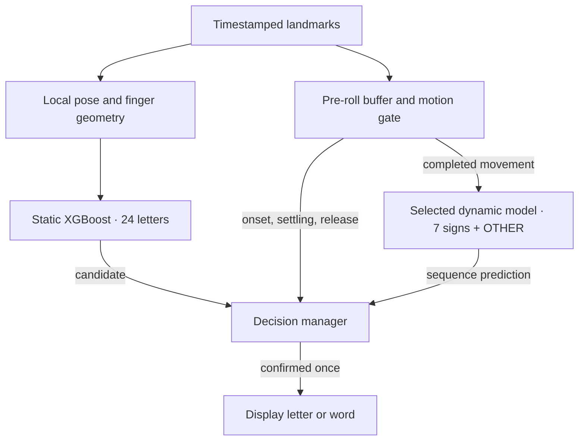

# ASL hand gesture recognition

Recognize **one isolated sign at a time** from a webcam or recorded clip. A signer can use either hand. The public vocabulary contains the 26 ASL letters and five words. Compare a per-frame MLP followed by a GRU against XGBoost on engineered trajectories from the same recordings. Both candidates use the same static classifier, landmark extractor and decision rules. [Design discussion](chatgpt-conversation://6afd62ed-d130-83ec-846e-36460ed44963) · [Implementation plan](implementation-plan.md)

## Vocabulary and user interaction

| Branch | Training classes | User-visible result |
| --- | --- | --- |
| Static | 24 letters, A through Z excluding J and Z | Emit one letter after the signer holds a stable pose. |
| Dynamic | `J, Z, HELLO, SORRY, THANK_YOU, YES, NO, OTHER` | Emit one of the seven target signs after the movement ends. `OTHER` suppresses output. |

Map the source folder `THANKYOU` to the model ID `THANK_YOU` and display it as **THANK YOU**. Store an ordered label map with each model. The UI can show a pending sign, a confirmed sign or a prompt to reposition the hand. A held sign emits once. To repeat it, the signer releases the pose and signs again. Continuous sentence transcription and simultaneous two-hand signs are outside this vocabulary.

## What is in the local dataset

The source of truth for this project is `data/SignAlphaSet/ASL_dynamic/<label>/<label>_clip<n>.avi`. The following counts come from the local copy. The dataset publication also describes a separate still-image collection. This feature uses the videos for both branches. [SignAlphaSet V3](https://data.mendeley.com/datasets/8fmvr9m98w/3)

| Local inventory | AVI files | Distinct AVI hashes | Consequence |
| --- | ---: | ---: | --- |
| 24 static letters | 240 | 239 | Sample stable poses within each recording. Give each recording equal weight. |
| J, Z, HELLO, SORRY, THANKYOU | 50 | 48 | Each folder has ten files. HELLO and SORRY each contain a duplicate. |
| YES and NO | 10 | 10 | Five clips per class. One error on a one-clip holdout changes that class's recall by 100 percentage points. |
| **Total** | **300** | **297** | Distinct hashes establish file uniqueness. Several files can still share a signer or recording session. |

The byte-identical pairs are `H_clip1/H_clip2`, `HELLO_clip1/HELLO_clip8` and `SORRY_clip1/SORRY_clip4` within their respective folders. All AVI headers report 640 × 480 at 30 fps, with durations from 0.57 to 5.63 s. Paired `*_frames/frame_*.jpg` exports exist for 290 clips. The ten S clips have only AVI files. Decode each AVI once. Treat a JPEG directory as another representation of its parent clip.

A spot check found a sideways subject in `SORRY_clip1` and obscured faces in some letter clips. Review orientation, visible anchors, hand identity, idle lead-in/out and label consistency on replay before choosing usable intervals. Record corrections as metadata and apply orientation correction before landmark extraction. An orientation peculiar to one class could otherwise become a shortcut for the classifier.

### Split and targets

1. Build one manifest row per source AVI with clip ID, relative path, source/model labels, SHA-256, group ID, optional signer/session ID, orientation, usable interval, split and review status. Keep an alias for each duplicate and count only its canonical recording in training and evaluation. Review near-duplicates and conflicting labels before freezing the split.
2. Prefer signer-disjoint groups when identities are documented. The local class folders and filenames expose no signer IDs. Use known recording/session groups where available, otherwise stratify by class at original-clip level with seed 42. Target 60/20/20 train/validation/test. With five independent recordings this gives 3/1/1. Keep groups intact if counts differ and report achieved support and missing classes. Describe a clip-only split as a **recording holdout**. It establishes no accuracy claim for unseen signers.
3. Extract static examples from stable, reviewed portions of the 24 letter classes. In dynamic training, use the annotated movement interval for each of the seven positives, including its onset. Build `OTHER` from the same split's static recordings and reviewed idle or transition intervals outside positive gestures. Cap its contribution per source clip. Include non-target hand movement in held-out replay when available. An absent hand is a quality state, never a training label.
4. Assign the split **before** sampling frames, windows, negatives or mirrored copies. Every derivative inherits its parent split across both branches. Fit any scaler on training data only. Snapshot the manifest and feature schema for both dynamic runs.

## From video to landmarks

Use OpenCV to decode BGR, convert to RGB and run MediaPipe Hand Landmarker in timestamp order. It includes palm detection, tracking, handedness and 21 three-dimensional hand points. Start with one active hand. Reset the sequence when the tracked hand changes, tracking is lost for a sustained interval, or a new clip or connection starts. Supply AVI presentation times (or frame index / verified fps) offline and monotonic elapsed time per live stream. The browser already mirrors the preview with CSS and captures the original video pixels. Verify the detector's handedness convention with real left and right hands on that capture path. [MediaPipe Hand Landmarker](https://ai.google.dev/edge/mediapipe/solutions/vision/hand_landmarker) · [Camera capture](../../app/frontend/src/hooks/useCamera.ts) · [Preview styles](../../app/frontend/src/styles.css)

Cache **raw** image landmarks as float32 `[N, 21, 3]`, timestamps, image size, handedness and score, observed-hand mask, and available body anchors with their own masks. Use Pose Landmarker for the nose, mouth corners and shoulders on the same RGB frame when body context is usable. The mouth midpoint approximates the mouth area and the shoulder midpoint gives an upper-torso reference. A hand-to-anchor offset uses image-plane x/y from both extractors. Their model-specific depth origins differ. The classifiers consume only features derived from these landmarks and their validity flags. [MediaPipe Pose Landmarker](https://ai.google.dev/edge/mediapipe/solutions/vision/pose_landmarker)

### Feature engineering shared by training and inference

| Signal | Construction | Purpose |
| --- | --- | --- |
| Local handshape | Convert normalized coordinates to common image-width units, `q = (x, y × H/W, z)`. Subtract wrist (0), divide by wrist-to-middle-MCP (9) distance, and flatten 21 × 3 coordinates. Mark degenerate scales invalid. Keep palm orientation. | Finger configuration and orientation for the static branch and the GRU. |
| Finger geometry | Add normalized thumb–index and thumb–middle tip distances, index–middle spread, and flexion angles at finger joints. Clamp the cosine for angles and mask zero-length bones. | Distinguishes similar static poses. Closing finger apertures supplies motion evidence for NO even when the wrist stays still. |
| Hand trajectory | Keep image-plane wrist (0), index tip (8) and pinky tip (20) **before wrist centering**. Subtract each point's segment-start position, divide by the median valid palm scale for the segment, and compute signed velocities using elapsed seconds. | The pinky traces J and the index traces Z. Wrist motion and changing handshape carry evidence for YES. Centering each frame at the wrist would erase whole-hand translation. |
| Body-relative position | Subtract nose, mouth midpoint and shoulder midpoint from wrist in the common image plane. Divide by shoulder width when valid. Carry a mask for each available offset. | Head proximity for HELLO, movement away from the mouth for THANK YOU and a torso-relative circular path for SORRY. |

**Missing data and time.** Track hand coverage and anchor coverage separately. Interpolate only short, bounded internal gaps on the same track (initial limit 100 ms), retaining an observed/interpolated mask. Reject windows with a longer hand gap, ambiguous hand switch or insufficient coverage (initial minimum 80% observed). Use a neutral fill plus a validity bit for a missing body offset. If training coverage is inadequate or mask availability itself identifies particular classes, select a hand-only schema for **both** candidates and document the limitation for the words. Freeze that schema for deployment. Resample each completed motion interval to 32 timestamps and compute speed using elapsed seconds on that grid. Keep original elapsed time for gating and latency.

**Left and right hands.** Use a consistent physical-side convention and one reliable handedness decision per sequence. During training, draw one flip decision for the **whole** raw sequence. For normalized image points use `x' = 1 - x`. The equivalent for wrist-relative vectors is `dx' = -dx`. Preserve frame order, joint IDs and class. Swap handedness and left/right anatomical anchor slots, mirror all reference points, then recompute offsets, velocities and angles. At inference use the capture convention used during extraction. The MVP learns both orientations through flipping. Full right-hand canonicalization is an alternative if handedness proves reliable. Applying it to both an original and its synthetic mirror would produce duplicate features. Validation and test retain the original recordings. Report real left/right support separately from synthetic mirror tests.

## Models and live decision

| Component | Input and training | Output |
| --- | --- | --- |
| Shared static XGBoost | One stable frame's local handshape and geometry. Use balanced per-clip sampling or weights and multiclass log loss. | 24 probabilities per frame, smoothed over a stable hold. |
| Dynamic XGBoost baseline | One fixed-width vector per window. For wrist, index and pinky, retain signed start-to-end displacement, path length, x/y range, speed summaries, and displacements in three ordered time bins. Add finger-aperture change, start/end pose, body-offset summaries, masks and duration. | Eight probabilities for one interval. Ordered bins distinguish paths that share endpoints. |
| Dynamic MLP + GRU | A batch `[B, 32, F]` of per-timestamp pose, geometry, trajectory, offsets and masks. A shared frame MLP `F → 64 → 32` feeds one unidirectional GRU (64 hidden units). Use its final state, a linear eight-logit head and cross-entropy. | Eight probabilities for the same interval. The GRU learns the order of handshapes and motion. |

Train the two dynamic classifiers independently. At runtime pick one from validation results. A motion gate combines smoothed, scale-normalized wrist/tip speed with changing finger apertures. Fit onset/offset thresholds and dwell times on validation replays, with a lower offset threshold to avoid rapid switching.

| State | Decision |
| --- | --- |
| Idle | On a valid hand, start a short timestamped pre-roll and enter static candidate. |
| Static candidate | Hold the leading static class pending. Sustained motion takes priority and opens a dynamic interval including pre-roll. Otherwise commit a confident, stable pose after the configured dwell. |
| Dynamic active | Suppress static commits. On sustained settling, run the selected classifier on the buffered interval. Commit one confident target. Reject `OTHER`, low confidence, timeout or a broken track. |
| Cooldown | Clear the candidate and require release or a distinct re-arm movement before a new commit. A lost connection clears all session state. |

For example, an I-shaped pose followed promptly by a moving pinky stays pending and can commit **J** once. A user who holds I beyond the static dwell has already committed **I**. Validate that dwell with real signers and tell users to begin a moving sign promptly. Use separate static and dynamic confidence thresholds.

## Evaluation and acceptance

- **Classifier comparison.** Score one prediction per held-out source clip for positives. Aggregate static frame predictions within the annotated hold. Report accuracy, macro-F1, per-class support/recall and confusion matrices for the 24-way static and eight-way dynamic tasks. Report `OTHER` window support and parent-clip counts separately. Both dynamic candidates see identical intervals, splits, masks and landmark coverage. Select the higher validation macro-F1. Break a tie at the reported precision using lower measured p95 latency on the demo machine. Freeze the classifier, gate and thresholds before test.
- **End-to-end replay.** Give the pipeline an entire clip, including entry and release. Score exactly one correct commit for each target clip. Report missed, wrong, duplicate and premature commits, plus false commits per minute of labelled idle/non-target footage. A rejected positive counts as a miss. Publish exclusions and extraction failures alongside the denominator. Break out I/J, Z, the five words, handedness and missing anchors where support permits.
- **Live acceptance.** Replay a stable hold, I-to-J, Z, finger-only NO, `OTHER`, no hand, a dropped track and a repeated sign after release. Require one correct emission for each scripted target and zero spurious emissions on the negative fixtures. Measure p50/p95 frame processing time from decode through decision, achieved stream fps, and gesture-end-to-commit delay on the named device. Use raw capture with each real hand for the demo check. A small clip holdout and synthetic flips alone cannot establish signer or handedness generalization.
