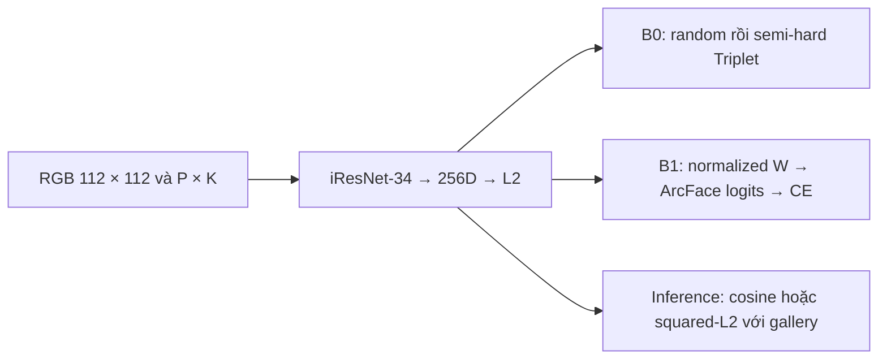

# Đề xuất so sánh Triplet Loss và ArcFace cho Facial Recognition

Cập nhật **01/11/2026**. Trạng thái: **tài liệu để duyệt; chưa triển khai model, pilot hoặc huấn luyện**.

## 1. Phạm vi và quyết định chính

So sánh hai cách học embedding trên **cùng iResNet-34, khởi tạo ngẫu nhiên, ảnh RGB 112 × 112 và embedding 256 chiều**. B0 tối ưu quan hệ giữa ảnh bằng Triplet Loss; B1 dùng ArcFace làm đối chứng học biểu diễn bằng phân loại có angular margin. Cả hai nhận diện ở inference bằng khoảng cách/cosine giữa embedding, không dùng logits identity train để nhận người mới.

| Thành phần | B0: Triplet | B1: ArcFace |
| --- | --- | --- |
| Encoder | iResNet-34 random, đầu ra 256D | Cùng encoder và cách khởi tạo |
| Objective huấn luyện | Squared-L2 Triplet trên embedding L2 | Cross-Entropy trên logits có additive angular margin |
| Margin cần sàng lọc | m ∈ {0,2; 0,3; 0,4}, đơn vị squared distance | m ∈ {0,3; 0,4; 0,5} radian, scale s = 64 |
| Dữ liệu theo batch | P = 8 identity × K = 4 ảnh = B = 32 | Cùng P × K và thứ tự ảnh/augmentation |
| Head riêng khi train | Mining trong batch, không có classifier | Ma trận W shape [432, 256], bias=False |
| Đầu ra khi inference | Embedding float32 256D chuẩn hóa L2 | Cùng dạng embedding; bỏ classifier W |

**B1 có classification trong objective huấn luyện.** Đây là nhánh đối chứng ArcFace trong phạm vi cập nhật, không được mô tả như Triplet thuần. Không dùng trọng số pretrained ở cả hai nhánh. Không trộn ArcFace và Triplet trong một loss hoặc thay backbone giữa hai nhánh.

## 2. Bằng chứng dữ liệu đã có và việc cần sửa

Đã chạy preprocessing và notebook trên bản sao ở lần khảo sát trước, audit toàn bộ file và kiểm tra transform. Lần cập nhật này dùng lại kết quả, không chạy lại audit hoặc tạo số liệu chất lượng mô hình. Đây là tập con local, khác VGGFace2 chính thức gồm 8.631 train/500 test identity. [VGGFace2 của tác giả](https://github.com/ox-vgg/vgg_face2)

| Thư mục hiện tại | Identity | Ảnh | Trung bình ảnh/identity | Min–max |
| --- | ---: | ---: | ---: | ---: |
| train | 480 | 176.398 | 367,50 | 102–720 |
| val | 60 | 21.295 | 354,92 | 136–644 |
| Tổng | 540 | 197.693 | 366,10 | 102–720 |

Audit giải mã được **197.693/197.693 ảnh JPG RGB**; không có file thiếu, file hỏng hoặc ảnh ngoài catalog. Không có tên identity giao hai thư mục. Có **83 nhóm trùng byte, 217 file, 134 bản dư**, đều trong cùng identity/split. Chưa kiểm tra near duplicate, alias identity, nhãn sai, landmark hoặc demographic; vì vậy các kiểm tra trên chưa chứng minh dữ liệu sạch hoàn toàn.

Width/height trung vị riêng từng chiều là 203/224 px; 15,63% ảnh có ít nhất một chiều dưới 112 px. EDA chất lượng lấy 8 ảnh/identity, tổng 4.320 ảnh với seed 42: brightness grayscale trung bình 109,89/255, contrast 61,80. Đây là mẫu cân bằng theo identity, không phải trung bình toàn bộ pixel dataset. Không dùng Laplacian variance như ngưỡng tự động loại ảnh mờ.

| Vấn đề đã phát hiện | Cách xử lý trước khi train |
| --- | --- |
| Summary JOIN ảnh–identity rồi avg(image_count) cho 396,4/399,3 | Tính trung bình ở cấp identity; dùng số 367,50/354,92 ở trên. |
| sample_limit lấy đầu catalog; smoke test chỉ có một identity | Kiểm tra batch P × K thật, gồm positive và negative hợp lệ. |
| Shuffle thông thường không bảo đảm positive trong batch | Dùng sampler theo identity cho cả B0 và B1. |
| pad_square chỉ pad toàn ảnh, không có landmark alignment | Thống nhất với crop vuông dùng trong app; không gọi padding là alignment. |
| crop_face trả BGR, transform NumPy giả định RGB | Chuyển BGR → RGB tường minh. |
| face_standard chỉ chuẩn hóa pixel | L2-normalize embedding riêng, trong float32. |
| Dataset bắt mọi exception và trả tensor zero mang nhãn thật | Fail-fast khi kiểm tra; quarantine theo manifest khi train, không âm thầm dùng ảnh zero. |
| Random erasing lỗi broadcast màu shape [3] | Tắt trong cấu hình chính; sửa và kiểm tra riêng trước khi cân nhắc. |

Giữ một đại diện mỗi nhóm trùng byte bằng manifest, kiểm tra near duplicate/alias trước khi khóa split; không xóa ảnh gốc. Bằng chứng chi tiết: [DATA_AUDIT](research/DATA_AUDIT.md), [audit_summary.json](research/audit_summary.json), [preprocessing_diagnostics.json](research/preprocessing_diagnostics.json), [notebook đã chạy](research/vggface2_executed.ipynb).

## 3. Encoder, preprocessing và kiểm soát so sánh

Tham khảo **iResNet-34 [3, 4, 6, 3]** của InsightFace, đặt num_features=256, dropout=0. Đầu cuối dùng Linear → BatchNorm1d; gamma của BatchNorm embedding giữ cố định bằng 1, beta được học, như implementation tham chiếu. Các BatchNorm còn lại và running statistics được cập nhật khi train, dùng eval mode khi đánh giá. Khởi tạo encoder theo cùng implementation cho hai nhánh. [Mã iResNet của InsightFace](https://github.com/deepinsight/insightface/blob/master/recognition/arcface_torch/backbones/iresnet.py)

Với mỗi seed, tạo một state khởi tạo encoder rồi sao chép chính xác cho B0/B1 và các margin. Tách RNG của khởi tạo head, sampler, augmentation và negative mining để head ArcFace không làm lệch chuỗi ảnh. Ghi seed và state/RNG vào checkpoint; không hứa bitwise-identical giữa các máy hoặc phiên bản thư viện.

Cấu hình ảnh chung: crop vuông theo bbox bằng `crop_face(..., size=112, scale=1.0)`, chuyển RGB, tensor [0,1], `mean=(0.5, 0.5, 0.5)`, `std=(0.5, 0.5, 0.5)`. Ảnh local đã được crop nên phải kiểm tra trực quan trước khi dùng toàn ảnh làm bbox; crop/padding cũ chưa được chứng minh tương đương crop webcam.

Train dùng horizontal flip p=0,5; brightness/contrast factor [0,9; 1,1] với p=0,5. Rotation, random erasing, MixUp/CutMix tắt. Dev/test/enrollment không dùng augmentation. Hai nhánh dùng cùng chuỗi batch và augmentation cho những epoch cùng được chạy; cấu hình transform được lưu cùng checkpoint.

Mỗi run có encoder state riêng. Sơ đồ mô tả hai objective thay thế nhau, không huấn luyện hai head đồng thời.

## 4. B0: Triplet Loss và curriculum có điều kiện đo được

Đặt z = g(x) / max(||g(x)||₂, 10⁻¹²), d²(i,j) = ||zᵢ − zⱼ||₂². Với embedding đơn vị, d² = 2 − 2zᵢᵀzⱼ thuộc [0,4]. Mỗi triplet có loss ℓ = max(0, d²(a,p) − d²(a,n) + m). Margin cố định trong từng run; optimizer cập nhật encoder, không học m bằng cách cho nó tự giảm.

Bắt đầu sàng lọc m = **0,2; 0,3; 0,4**. Margin squared-distance không phải ngưỡng verification và không thể sao chép sang ArcFace. torch.nn.TripletMarginLoss(p=2) dùng L2 không bình phương: implementation dự án phải tính squared-L2 tường minh và dùng cùng distance trong miner. [FaceNet](https://arxiv.org/abs/1503.03832), [PyTorch TripletMarginLoss](https://docs.pytorch.org/docs/2.11/generated/torch.nn.TripletMarginLoss.html)

Đặt M=B(K−1): mỗi batch chính B=32, K=4 có **M=96 cặp anchor–positive có hướng**; fallback B16 có M=48. Lấy toàn bộ M cặp. Hai ảnh A/P khác nhau, cùng identity; negative khác identity. Không cần ba encoder độc lập: forward 32 ảnh một lần, tạo distance matrix rồi chọn negative. Không tạo tensor B³.

**Giai đoạn random:** với mỗi A/P chọn đúng một negative đồng đều từ 28 ảnh thuộc 7 identity còn lại trong batch. Loss batch là tổng 96 hinge loss chia **96**, bao gồm cả triplet dễ có loss bằng zero. Negative có thể được dùng lại giữa các A/P khác nhau.

**Probe cố định để quyết định chuyển giai đoạn:** từ 432 identity train, tạo 4 triplet/identity = **1.728 triplet**, seed 42, từ ảnh hợp lệ sau deduplication. A/P khác ảnh; N khác identity. Không dùng dev/test cho điều kiện curriculum. Probe không phải tín hiệu gradient.

Cuối mỗi epoch, chạy probe ở eval mode, không augmentation, không cập nhật BatchNorm hoặc trọng số; sau đó khôi phục train mode. Đo ba đại lượng trên cùng probe:

- q = tỷ lệ triplet có d²(a,p) < d²(a,n); bằng nhau tính là thất bại.
- g = trung bình d²(a,n) − d²(a,p).
- v = trung bình theo 256 tọa độ của standard deviation embedding trên các **ảnh probe duy nhất**, dùng correction=0.

Chuyển **một chiều**, có hiệu lực từ epoch kế tiếp, khi đã học ít nhất **5 epoch random** và cả **3 lần kiểm tra cuối liên tiếp** cùng đạt q ≥ 0,75, g ≥ 0,05, v > 0,001. Đây là **heuristic engineering đề xuất**, chưa được đo hoặc khẳng định bởi FaceNet. Nó kiểm tra ranking đúng và tránh coi embedding collapse là đạt điều kiện.

Nếu chưa đạt sau epoch 15, chỉ gắn cờ để phân tích và tiếp tục random trong ngân sách đã duyệt; không ép chuyển hoặc đổi margin. Nếu kết thúc run mà chưa đạt, báo rõ **chưa hoàn tất curriculum**, không gọi đó là kết quả random→semi-hard thành công.

**Giai đoạn semi-hard:** cho mỗi A/P, chọn đồng đều một negative thỏa d²(a,p) < d²(a,n) < d²(a,p)+m. Nếu không có, đóng góp của A/P đó bằng zero nhưng vẫn nằm trong mẫu số **96**. Không thay bằng hardest negative hoặc tự resample batch.

Nếu toàn batch không có candidate semi-hard, bỏ optimizer update, vẫn tính batch vào draw budget và ghi nhận số lần forward/skip. Batch có tổng loss zero cũng không tạo update AdamW giả chỉ vì weight decay. Nếu tỷ lệ batch không có candidate >20% trong 2 epoch liên tiếp, gắn cờ chẩn đoán; không tự thay miner/margin. Quy tắc giảm loss này phải được giữ nguyên giữa các run, không thay bằng trung bình chỉ các triplet active.

FaceNet cung cấp cơ sở cho normalized squared-L2 và semi-hard; chính sách random trước, probe và điều kiện chuyển ở trên là thiết kế dự án. Hardest-negative, XBM hoặc adaptive margin nằm ngoài so sánh chính để tránh thêm biến số. [FaceNet](https://arxiv.org/abs/1503.03832)

## 5. B1: ArcFace và head phân loại chỉ dùng khi train

Mỗi identity train ánh xạ vào nhãn liên tục 0…431. Head có **432 × 256 = 110.592 trọng số**, không bias, một center/class, khởi tạo Xavier uniform bằng RNG riêng. Mỗi hàng Wⱼ được chuẩn hóa L2 khi tính cosine; embedding và W cùng được học. Tính **đầy đủ 432 logits**, không PartialFC hoặc negative-class sampling.

Đặt cⱼ = zᵀ(Wⱼ/||Wⱼ||₂) = cos θⱼ. Logit ngoài target là s·cⱼ; target dùng s·cos(θᵧ+m) trong miền thích hợp. Loss là Cross-Entropy trung bình trên 32 ảnh. Dùng **s=64** cố định, sàng lọc angular margin **0,3; 0,4; 0,5 radian**. Chỉ target logit nhận margin. [ArcFace, bản v3, công thức (3)](https://arxiv.org/pdf/1801.07698v3)

Chọn biến thể **easy_margin=False với monotonic fallback** tham khảo OpenMMLab. Đặt c = clamp(cᵧ, −1+10⁻⁷, 1−10⁻⁷), rồi tính trong float32:

\[
\phi(c)=\begin{cases}
c\cos m-\sqrt{\max(1-c^2,0)}\sin m,&c>\cos(\pi-m),\\
c-m\sin(\pi-m),&\text{ngược lại}.
\end{cases}
\]

Dùng φ(c) cho target, các cosine còn lại giữ nguyên ngoài clamp an toàn số học. Đây là lựa chọn implementation cụ thể cho dự án; không tuyên bố giống hệt forward hiện hành của mọi phiên bản InsightFace. Code cần kiểm tra finite gradient gần biên cosine, đúng target mask và CE. [OpenMMLab margin_head.py](https://github.com/open-mmlab/mmpretrain/blob/main/mmpretrain/models/heads/margin_head.py)

**Không tính dev Cross-Entropy trên head 432 lớp**: 48 identity dev chưa được thấy và không có hàng W tương ứng. Dev/test chỉ xuất embedding để verification và identification theo cùng protocol B0. Train CE/accuracy chỉ là log chẩn đoán B1, không được đem so trị số với Triplet Loss hoặc dùng như thước đo tổng quát chính.

Khi export, bỏ W và angular margin; embed(face) trả vector float32 256D chuẩn hóa L2. Enrollment thêm người mới bằng embedding, không mở rộng classifier hoặc train lại head để chạy inference.

## 6. Sampler, optimizer, lịch học và ngân sách

Dùng P × K sampler chung: mỗi batch chọn 8 identity đồng đều, mỗi identity 4 ảnh không lặp **trong batch**. Ảnh có thể xuất hiện lại ở batch khác. Cùng seed tạo cùng lịch batch/augmentation cho B0/B1; negative mining dùng RNG riêng.

Gọi N_train_unique là số ảnh train còn lại sau deduplication trong 432 identity. Một epoch gồm **ceil(N_train_unique / 32) batch đầy đủ**. Đây là ngân sách lấy mẫu có hoàn lại qua các batch, không phải một lần quét hết mọi ảnh. Không dùng số 176.398 của thư mục train trước khi tách dev như N_train_unique.

| Tham số chung | Giá trị chốt cho so sánh chính |
| --- | --- |
| Batch và gradient accumulation | B=32, P=8, K=4; accumulation=1 |
| Optimizer | AdamW; LR peak 3×10⁻⁴; `betas=(0.9, 0.999)`; eps=10⁻⁸ |
| Weight decay | 10⁻⁴ cho Conv/Linear weights, gồm W ArcFace; 0 cho BN, bias và PReLU |
| Ngân sách | Tối đa 60 epoch; không tự kéo dài run để bù update bị skip |
| Warmup | 5 epoch đầu, tuyến tính từ 1% peak LR tới peak |
| Sau warmup | Cosine decay theo tiến độ batch dự kiến tới LR 10⁻⁶ ở cuối epoch 60 |
| Gradient clipping | Global L2 norm 5,0; unscale trước clipping khi dùng GradScaler |
| Precision | CUDA autocast fp16 + GradScaler; normalization, distance, mining và loss float32 |
| Dev mỗi epoch | eval/inference mode, không augmentation, không cập nhật BN |
| Early stopping | Từ sau tối thiểu 15 epoch; patience 10 lần kiểm tra dev |
| Chọn checkpoint | TAR@FMR≤10⁻³ trên dev; hòa thì AUC lớn hơn, còn hòa chọn epoch sớm hơn |

LR dùng tiến độ batch đã lên kế hoạch, kể cả batch B0 bị skip; ghi nhận LR và **số optimizer update thực**, không gọi hai run có cùng số update nếu chúng khác nhau. Với ArcFace, margin arithmetic, logits và CE thực hiện float32 ngoài autocast. CPU chỉ dùng float32 cho kiểm tra, không coi đó là chế độ huấn luyện chính.

Patience chỉ reset khi TAR dev cải thiện nghiêm ngặt; AUC dùng để phá hòa khi chọn checkpoint. Khi B0 chuyển semi-hard, reset bộ đếm patience một lần và cho ít nhất **5 epoch semi-hard** trước khi early stop nếu ngân sách 60 epoch còn đủ. Nếu chỉ còn ít hơn 5 epoch, chạy phần còn lại và ghi rõ giới hạn; không tự vượt 60. Không reset optimizer, LR hoặc trọng số ở điểm chuyển.

Đây là cấu hình engineering khởi đầu, chưa chứng minh tối ưu cho iResNet random trên 432 identity. So sánh giữ cùng optimizer và ngân sách lấy mẫu để giới hạn biến số; early stopping và số batch B0 skip vẫn có thể làm chi phí/update thực khác nhau và phải báo cáo.

## 7. Cấu hình máy, Windows DataLoader và pilot sau duyệt

[Runtime profile ngày 01/11/2026](research/runtime_profile_2026-11-01.json) ghi nhận CPU **i5-14600KF, 14 core vật lý/20 logical**, RAM **31,82 GiB**, GPU **RTX 3070 Ti 8 GiB**. Ở thời điểm probe có 5.482 MiB VRAM free; đó là số động, không phải bộ nhớ được dành riêng cho model.

Máy chạy **Windows 11**, Anaconda Python **3.13.9**. PyTorch hiện là **2.11.0+cpu**, torchvision **0.26.0+cpu**, CUDA unavailable. Workaround OpenMP chỉ áp dụng trong process con khi khảo sát; cần môi trường PyTorch CUDA sạch trước pilot. Đề xuất môi trường training riêng với Python **3.11**, cặp PyTorch/torchvision hỗ trợ CUDA tương thích; ghi version thực tế sau khi cài và kiểm tra. **Chưa dựng model, đo VRAM, backward, time/step hoặc huấn luyện; không cài môi trường trong bước soạn đề xuất này.**

Smoke test synthetic CPU DataLoader đã qua với **2 worker, spawn, persistent_workers=True, prefetch_factor=2**, qua hai vòng dataset. Test này không dùng ảnh/model, không xác nhận pinned-memory transfer hoặc khả năng chứa B=32 trên GPU. Bằng chứng ở runtime profile và [script smoke](research/runtime_dataloader_smoke_2026-11-01.py).

| Runtime đề xuất cho script train | Cấu hình |
| --- | --- |
| Luồng process chính | torch.set_num_threads(8), torch.set_num_interop_threads(1), đặt trước parallel work |
| DataLoader | num_workers=2, multiprocessing_context='spawn', persistent_workers=True, prefetch_factor=2 |
| Luồng trong worker | 1 thread/worker; seed Python/NumPy từ worker seed; augmentation theo seed mẫu để tái lập |
| Transfer | pin_memory chỉ khi CUDA available; non_blocking transfer khi dùng pinned batch |
| Notebook/debug fallback | num_workers=0, persistent_workers=False; bỏ prefetch_factor/multiprocessing_context |

Đặt Dataset, collate_fn và worker_init_fn ở top-level để pickle được; không dùng lambda hoặc closure cho worker. Script có if __name__ == '__main__' và freeze_support(). Custom batch_sampler chỉ phát batch đầy đủ; **không truyền đồng thời batch_size, shuffle, sampler hoặc drop_last của DataLoader**. Chính sampler xử lý phần batch chưa đủ. Nạp metadata trước khi tạo worker, đóng DuckDB connection; không truyền connection đang mở qua spawn. [PyTorch 2.11 DataLoader](https://docs.pytorch.org/docs/2.11/data.html), [Windows FAQ](https://docs.pytorch.org/docs/2.11/notes/windows.html)

Sau khi duyệt, xác minh CUDA rồi pilot chung tại **B=32, P=8, K=4**: đo peak allocated/reserved VRAM, throughput và finite loss/gradient cho cả hai objective. Nếu một nhánh OOM, hạ **cả hai** xuống B=16, P=4, K=4, cập nhật mẫu số B0 từ 96 thành 48 và epoch budget ceil(N_train_unique/16), rồi bắt đầu lại toàn bộ so sánh chính cùng cấu hình. Không so trực tiếp run cũ B32 với run mới B16 như cùng điều kiện.

B=64 chỉ là thí nghiệm bổ sung sau này, ngoài ma trận chính; gradient accumulation không tự làm tăng tập negative của Triplet. Khả năng chạy và thời gian hoàn thành 10 run chưa được đo; pilot phải ghi ước tính thời gian trước khi khởi động screening.

## 8. Split, verification và open-set chung

Dùng seed **42**, chia logic **432 train / 48 dev / 60 test** theo identity: tách 48 identity từ train hiện tại làm dev; toàn bộ val hiện tại thành final test. Giữ nguyên thư mục gốc, lưu manifest/version/hash và mapping 432 lớp. Kiểm tra alias/duplicate trước khi khóa; chưa áp dụng split trong giai đoạn tài liệu.

Cặp evaluation không phụ thuộc miner/model. Positive lấy đều theo identity, hai ảnh khác nhau và khác nhóm duplicate; negative lấy đều theo cặp identity. Cố định pair manifest cho mọi run. Dự kiến **200 genuine pairs/identity, 100 impostor pairs/cặp identity**: dev 9.600/112.800 cặp; test 12.000/177.000 cặp. Số thực tế xác nhận sau deduplication.

Dùng cosine similarity float32, score cao là giống; squared-L2 cho thứ tự tương đương trên vector đơn vị. Trên dev, chọn ngưỡng có TAR cao nhất trong các ngưỡng thỏa empirical FMR≤10⁻³; dùng quy ước accept score≥τ nhất quán khi có ties. Đây cũng là metric chính chọn checkpoint/margin, bổ sung TAR@10⁻², ROC-AUC, EER và score distributions.

Mỗi run có ngưỡng riêng được calibrate trên dev, không ép dùng chung giá trị τ giữa B0/B1. Sau khi chọn cấu hình/checkpoint, khóa ngưỡng rồi báo **TAR và FMR thực trên test**. ROC/EER hoặc TAR@FMR trên đường cong test là mô tả, không lấy ngưỡng test để đưa vào app. Không chọn mô hình/hyperparameter dựa trên test. [A Metric Learning Reality Check](https://arxiv.org/abs/2003.08505)

Báo CI 95% bằng bootstrap giữ nhóm identity, xử lý phụ thuộc của cả hai identity trong impostor pair; không coi các cặp dùng lại ảnh/người là độc lập. Với FMR 10⁻³ và 100.000 negative chỉ có khoảng 100 lỗi kỳ vọng; nhiều cặp không thay thế nhiều người. Công bố số identity, ảnh/cặp, seed và số bootstrap, không khẳng định độ tin cậy rất thấp từ tập test nhỏ. [NISTIR 7730](https://tsapps.nist.gov/publication/get_pdf.cfm?pub_id=906977)

Kiểm định 1:N giữ gallery **30 identity** ở cả dev/test: dev có 18 unknown identity, test 30 unknown. Mỗi enrolled identity lấy **3 ảnh enrollment**, trung bình embedding rồi L2-normalize lại. Genuine probe cùng người nhưng khác ảnh/nhóm duplicate; unknown probe vắng mặt trong gallery. Manifest enrollment/probe cố định cho các model.

Báo Rank-1 trên genuine probe; TPIR/DIR ở rank 1 yêu cầu **đúng người và vượt ngưỡng**, FPIR là tỷ lệ lượt unknown probe có ít nhất một candidate vượt ngưỡng. Calibrate τ_1:N riêng trên dev, giữ nguyên khi test, báo FPIR/TPIR thực và số probe. Pair-FMR khác FPIR theo lượt tìm kiếm; gallery thay đổi có thể làm FPIR thay đổi. Chỉ 18/30 unknown identity nên đây là kiểm định demo, không chứng minh mức FPIR thấp khi triển khai rộng. [NIST FRTE 1:N](https://pages.nist.gov/frvt/html/frvt1N.html)

Webcam là kiểm định bổ sung: người đánh giá không nằm trong train/dev; enrollment và genuine probe cùng identity nhưng khác phiên quay; unknown không nằm trong gallery. Ảnh celebrity không thay thế được kiểm định domain webcam.

## 9. Ma trận 10 run và tiêu chí diễn giải

| Giai đoạn | Run | Seed | Quyết định |
| --- | --- | --- | --- |
| Screening B0 | m=0,2; 0,3; 0,4 | 42 cho mỗi margin | Chọn một margin B0 bằng dev |
| Screening B1 | m=0,3; 0,4; 0,5 rad; s=64 | 42 cho mỗi margin | Chọn một margin B1 bằng dev |
| Xác nhận B0 tốt nhất | Margin đã chọn, cùng curriculum | 123 và 2026 | Cộng run seed 42 thành 3 seed |
| Xác nhận B1 tốt nhất | Margin đã chọn, cùng head | 123 và 2026 | Cộng run seed 42 thành 3 seed |

Tổng **6 run screening + 4 run bổ sung = 10 run**, không chạy lại seed 42 thừa. Split và pair manifests vẫn seed 42; seed 123/2026 chỉ thay initialization và RNG huấn luyện. Giữ cùng initial encoder state theo seed ở các nhánh. Mỗi run lưu checkpoint tốt nhất theo dev và ngưỡng của chính run; khi báo test mean/std trên 3 seed phải công bố rằng seed 42 đã tham gia chọn margin, không coi ba seed là ba lần tuning độc lập.

Log B0: giai đoạn, epoch chuyển, q/g/v probe, số A/P có candidate/active, mẫu số loss, empty-batch/zero-loss rate và số update thực. Log B1: train CE, accuracy, norm W và tỷ lệ target dùng fallback. Cả hai log dev TAR/FMR/AUC/EER, norm/độ phân tán embedding, LR, forward/optimizer count, time/step, peak VRAM, tổng thời gian và cấu hình máy.

Kết luận dựa trên mean/std verification và open-set, CI theo subject và chi phí thực. Không so trực tiếp độ lớn CE với Triplet Loss, không tuyên bố hơn kém chỉ vì loss train thấp. Nếu B0 không chuyển được curriculum hoặc thường xuyên không có negative hợp lệ, báo giới hạn đó thay vì âm thầm đổi thiết kế rồi gộp kết quả.

## 10. Các bước thực hiện sau khi duyệt

1. Tạo môi trường CUDA sạch; thống nhất shared crop, sửa lỗi preprocessing và kiểm tra dữ liệu/manifest.
2. Triển khai encoder chung, P × K sampler, loss/miner/probe B0 và head ArcFace B1 với kiểm tra số học có ý nghĩa.
3. Pilot B32 cho hai nhánh; nếu cần B16, cập nhật chung và khóa cấu hình trước screening.
4. Chạy 6 run screening trên dev, khóa margin mỗi nhánh rồi chạy thêm 4 run xác nhận.
5. Khóa checkpoint/ngưỡng; đánh giá test, open-set và webcam; export embedding interface kèm metadata.

Phạm vi cần duyệt: **cùng iResNet-34 random 256D; B0 Triplet random→semi-hard; B1 ArcFace; cấu hình B32 chung và fallback B16; split 432/48/60; ma trận 10 run và protocol đánh giá trên**. Các con số runtime CPU/loader đã đo không phải kết quả huấn luyện. Dữ liệu gốc và các audit trước vẫn được giữ nguyên.
